# 今天能摆吗？ · Can I Take a Break?

<h2 align="center">🌐 <a href="https://novafliex.github.io/can-i-take-a-break/">点击进入完整展示页 →</a></h2>

真实界面 · 玩法介绍 · 管理中心 · 演示视频 · 技术架构 
<a href="https://novafliex.github.io/can-i-take-a-break/">novafliex.github.io/can-i-take-a-break</a>

> 让小情绪，被看见、被回应。

《今天能摆吗？》是**一个以日常小纠结为入口的轻量情绪互动社区**。它把难以开口的疲惫、犹豫和小烦恼，变成一份可以被别人认真回应、也可以被轻松调侃的公开申请。

用户以「摆烂申请」开场，其他人通过赞成、反对和评论参与，申请者还可以发布后续经历。通过**申请 → 表态 → 讨论 → 后续故事**，让一个人的小情绪，变成一群人共同参与的小故事。

它不是普通的投票工具、传统匿名树洞，也不是帮助用户做决定的软件。核心价值是让想法被看见、理解和回应；创新体现在**情绪表达方式、互动机制与后续反馈机制的结合**。

本仓库是项目的**公开展示仓库**（产品介绍、技术文档、架构说明与展示页）。小程序与 Go 后端的开发仓库独立维护，此处不包含业务代码与任何密钥配置。

---

## 项目初衷

生活已经够认真了，偶尔也可以不那么正经。

「今晚能不去聚会吗」「今天能休息一下吗」——这些小纠结未必需要别人给出答案，却值得有人听见。用带有幽默感的申请形式，降低表达的心理负担，让陌生人能认真回应，也能善意调侃。投票只是交流的入口，评论与后来发生的故事让互动有了延续。

我们希望创造一个轻松、低门槛的表达空间。赞成与反对都不具有约束力，生活由申请者自己选择。

## 真机高清界面 · 2026-10-29

本次使用维护者提供的 **33 张手机真机原图（1170×2532）**，只重命名并逐字节复制，不裁切、不缩放、不修改画面。三套主题、投票、申请详情、评论、文章和欢迎页均使用这批原图。

### 申请 → 表态 → 讨论 → 后续故事

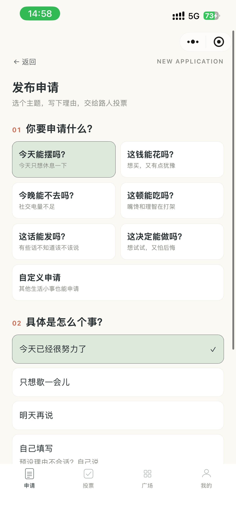 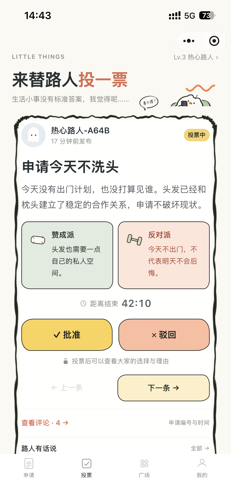

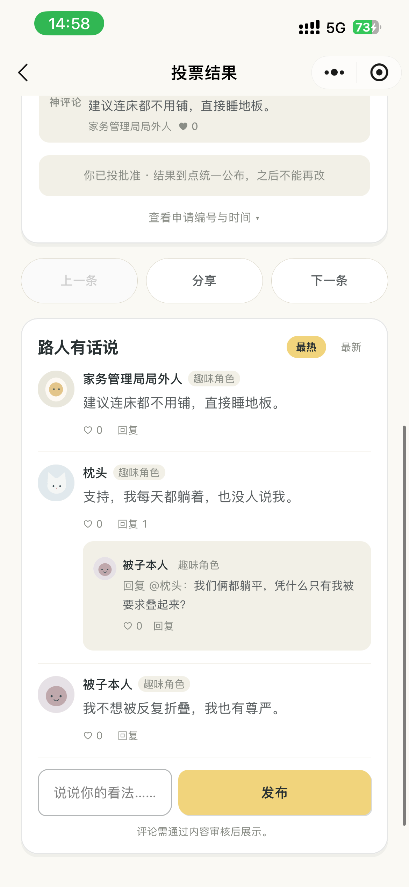 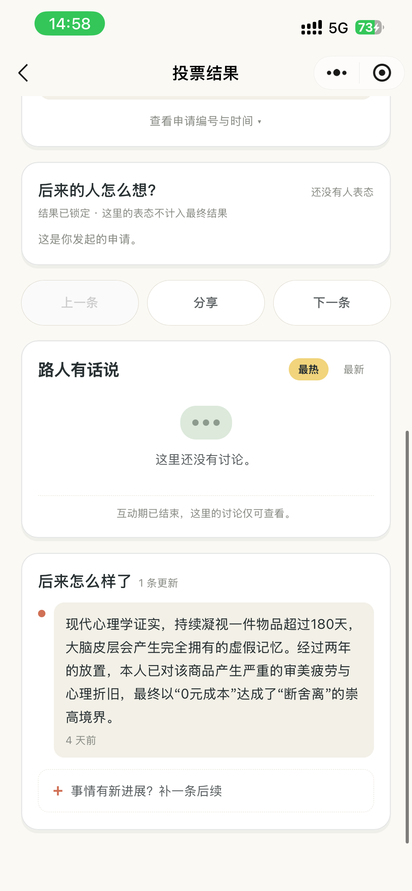

申请表单与后续故事均已换为 **1170×2532 手机真机原图**。上图展示不同页面，并非同一份申请的连续故事。画面包含官方话题、趣味角色与体验记录，人数与票数只是截图时状态，不代表社区运营规模。

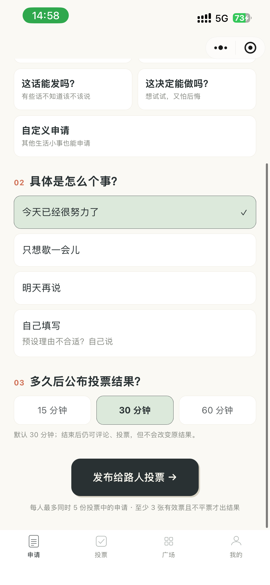 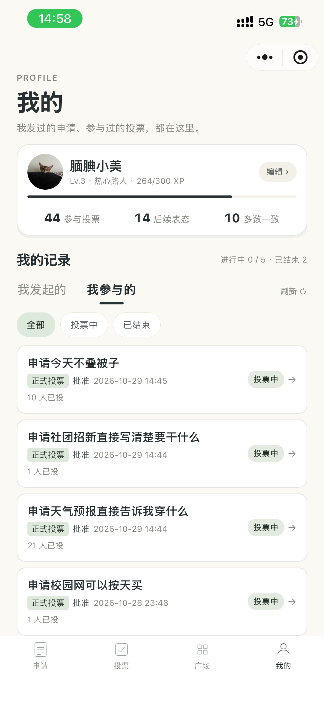

### 三套可切换主题

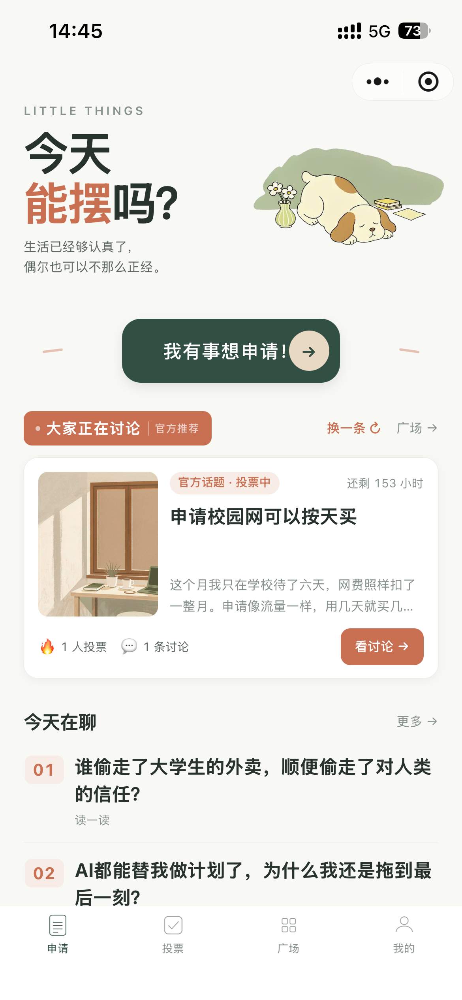  

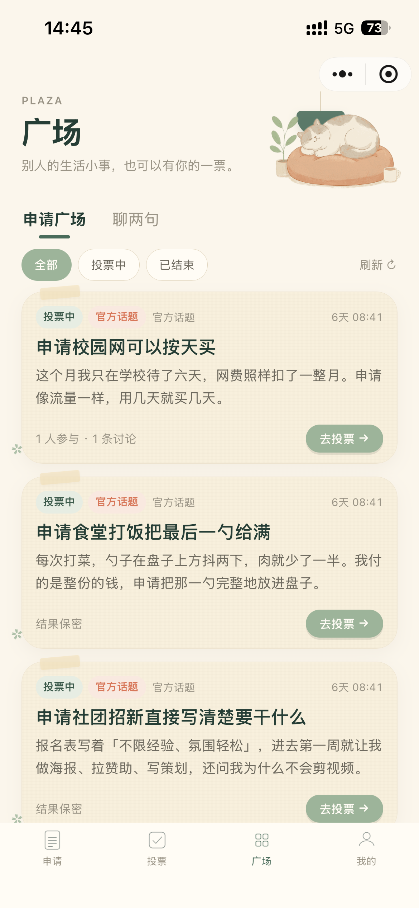 

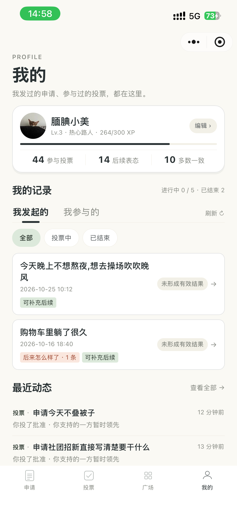 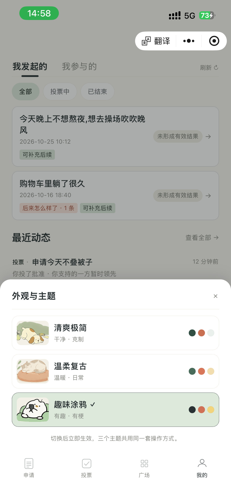

### 阅读与欢迎引导

  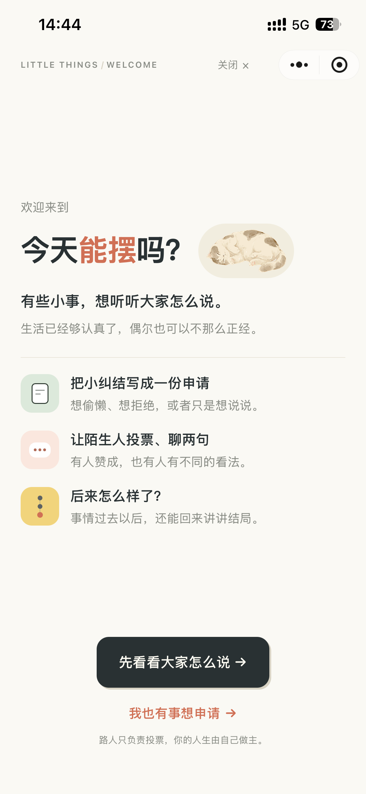

### 管理中心

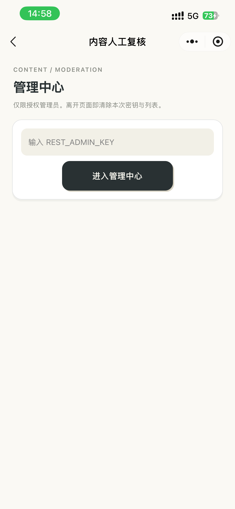

三套主题的完整图组见[展示页](https://novafliex.github.io/can-i-take-a-break/#themes)。全部原图用途与 SHA-256 见[截图清单](assets/screenshots/SCREENSHOTS.md)和[真机素材记录](assets/screenshots/phone-capture-20261029.json)。管理中心已使用新版空密钥授权入口真机图；授权后的处理列表与审计记录尚未展示。

## 核心功能

产品的互动主线是申请、表态、讨论和后续故事；以下为页面入口与配套能力：

| 玩法 | 页面 | 说明 |
| --- | --- | --- |
| **摆一下** | 申请 · 投票 | 从 6 个预设主题（今天能摆吗 / 这钱能花吗 / 今晚能不去吗……）或自定义内容发起申请，写下理由，选 15/30/60 分钟限时投票；其他用户抽卡式浏览并投出「批准 / 驳回」，可附一句理由。 |
| **看热闹** | 广场 · 详情 | 浏览所有人的申请：投票中的实时倒计时、已结束的比例结果与「神评论」；截止后 7 天内仍可「后续表态」而不改变已锁定的结果；申请人可以追加「后续来了」故事线。 |
| **聊两句** | 文章 · 评论 | 编辑部栏目（今天在聊 / 人间观察 / 离谱研究所）的轻量内容，读文章、聊话题，还能从文章一键发起同款申请。 |

围绕主线的配套机制：

- **先审后展示的内容安全**：所有用户自由文本（评论、自定义标题、理由）先经微信内容安全接口检测，未过审不公开，检测服务不可用时宁可拒绝发布（fail-closed）；
- **评论互动闭环**：两级楼中楼、点赞、举报（3 人举报自动隐藏转人工复核）、对自己评论的删除与申诉；
- **轻成长系统**：投票、与多数派一致都会积累 XP 与等级称号；
- **隐私与申诉**：小程序内直接提交查阅 / 更正 / 删除 / 注销 / 申诉五类请求，管理员在后台处理并回复；
- **三套主题**：clean（清爽）/ retro（复古绘本）/ fun（涂鸦）全站换肤，原生导航栏与 tabBar 一起切换；
- **管理后台**：评论复核、文章上下架、请求处理，每步操作留追加式审计记录，业务接口不提供修改或删除。

## 技术栈

以下工程数据为 2026-10-25 快照，供了解实现思路；新版开发仓库已继续演进。

| 层 | 选型 | 说明 |
| --- | --- | --- |
| 小程序前端 | 原生 WXML / WXSS / JavaScript | 无第三方框架，9 个页面，自研请求封装与主题系统 |
| 后端 | Go 1.23，标准库 `net/http` | 唯一第三方依赖是 MySQL 驱动 `go-sql-driver/mysql`，无 Web 框架、无 ORM |
| 数据库 | MySQL 8（云托管内网） | 10 张业务表，本地开发可用同构的 JSON 文件存储 |
| 部署 | 微信云托管（CloudBase Run） | Docker 多阶段构建、非 root 运行，小程序经 `wx.cloud.callContainer` 内网调用，不暴露公网域名 |
| 内容安全 | 微信 `msg_sec_check` v2 | 全部 UGC 先审后发 |
| 测试 | `go test` + Node.js 内置 `node:test` | 后端 22 个测试文件，前端 102 项回归测试 |

## 系统架构

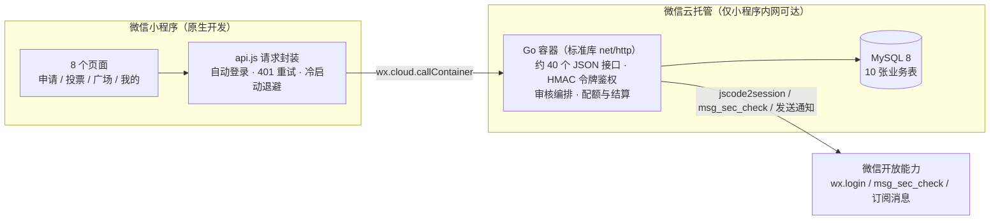

完整的模块划分、请求生命周期与设计决策见 [docs/architecture.md](docs/architecture.md)。

## 重点技术实现

以下每一项都对应开发仓库中的真实代码与测试，细节与取舍见 [docs/backend.md](docs/backend.md)：

1. **投票防重复与并发一致性**——`bureau_votes` 表以 `(application_id, user_id)` 为主键从存储层杜绝重复投票；写操作统一进短事务，先以 `SELECT ... FOR UPDATE` 拿全局写序锁，再在同一事务内完成「加载 → 业务规则 → 差量落库」。集成测试实测：40 个并发投票只接受 21 票（受单申请 21 票封盘约束），24 个并发建申请只成功 5 份（受同时进行 5 份的配额约束）。
2. **幂等结算与快照回滚**——到期结算（≥3 票且不平票才出结果）以快照方式写入，写盘失败自动回滚并返回 503，重试不会重复结算；重复调用结算接口结果不变。
3. **fail-closed 内容安全**——评论、自定义申请、投票理由等自由文本一律先过微信 `msg_sec_check`；审核接口不可用时返回 503 拒绝发布，而不是放行；人工复核结果永不被自动流程覆盖。
4. **隐私优先的身份设计**——openid 不落明文：用户 ID 由 openid 的 HMAC-SHA256 派生，openid 本体以 AES-256-GCM 加密存储；登录令牌为自研 HMAC 签名的无状态 token（7 天有效），鉴权比较使用常量时间算法。
5. **双存储同构**——同一套业务逻辑跑在两种存储后端上：本地开发用原子写盘的 JSON 快照，线上用 MySQL；切换只靠环境变量，不改业务代码。
6. **可恢复性与可观测性**——内置备份 / 恢复 CLI（一致性事务 + SHA-256 校验和 + 空库保护）、`/health` 与 `/health/ready` 探针；广场列表用 keyset 游标分页，翻页不重不漏。
7. **部署守卫**——部署脚本做白名单打包（拒绝任何 `.env*` 与数据文件进入镜像）、对输出日志实时脱敏密钥，并在打包前静态断言关键路由与建表语句存在，防止「代码在包里、路由没注册」这类真实发生过的事故。

## 项目工程亮点

- **零框架后端**：约 7300 行 Go（不含测试）只依赖一个 MySQL 驱动，路由用 Go 1.22+ 的方法匹配 `http.ServeMux` 手工分发，换来完全可控的响应格式、超时与错误语义；
- **测试占后端代码约三分之一**：22 个测试文件 / 4066 行，覆盖单元、`httptest` 端到端、真 MySQL 多实例并发与迁移恢复场景；前端另有 102 项基于 `node:test` 的页面逻辑回归（注入 `wx` 桩直接驱动真实 `Page()` 对象），含竞态、乐观更新回滚与文案口径断言；
- **前端工程质量**：401 自动换令牌重放、云托管冷启动的 GET 退避重试（写请求绝不重放）、响应版本号防竞态、点赞乐观更新失败回滚、空 / 错 / 骨架三态齐全；
- **内容冷启动设计**：18 条演示申请 + 15 条按 90 分钟时间槽轮换值守的选题（任意时刻恰好 5 条可投）+ 33 篇编辑部文章包，全部幂等补种、与真实用户数据严格隔离。

## 功能演示

- 演示视频：[demo/demo-video.mp4](demo/demo-video.mp4)（约 4 分钟，1080p，14MB——源素材为 4K 录屏压缩入库；录制于早期版本，界面与当前版本有差异，待重录，见 [demo/DEMO.md](demo/DEMO.md)）。
- 截图素材现状与补采计划见 [assets/screenshots/SCREENSHOTS.md](assets/screenshots/SCREENSHOTS.md)。
- 静态展示页（GitHub Pages）见 [site/](site/) 目录，预览方式见其中的说明。

## 项目状态

截至 2026-10-25：

| 项 | 状态 |
| --- | --- |
| 小程序 | 历史发布记录（2026-10-23）：业务版本 V2.2.1，已完成 102 项前端回归与全量 Go 测试；体验版已上传（2026-10-23），核心功能已完成，目前通过体验版展示与收集反馈 |
| 后端 | 云托管最新发布于 2026-10-23（发布记录 can-i-api 032 见开发仓库文档），运行于微信云托管内网 |
| 视觉 | V3.0 全局视觉重构（三主题、CSS 变量设计系统），2026-10-24 完成 |
| 待办 | 真机多账号验收、演示视频录制、体验反馈整理，详见 [docs/roadmap.md](docs/roadmap.md) |

核心功能已完成。由于个人主体在社交互动类目上的准入限制，目前通过体验版展示与收集反馈。

## 后续迭代规划

已完成与进行中的事项见 [docs/roadmap.md](docs/roadmap.md)。候选方向（均为规划，不代表已实现）：

- 结果分享海报与更多趣味互动形态；
- 成就 / 徽章系统（前端已预留扩展位，刻意未开发半成品入口）；
- 备份自动化与云 MySQL 备份策略确认；
- 持续收集体验反馈；未来如调整主体或服务范围，再按对应类目要求推进。

## 文档导航

| 文档 | 内容 |
| --- | --- |
| [docs/product.md](docs/product.md) | 产品定位、目标用户、设计原则与内容边界 |
| [docs/features.md](docs/features.md) | 功能清单、用户流程与完成状态 |
| [docs/architecture.md](docs/architecture.md) | 系统架构、模块划分、请求生命周期与关键决策 |
| [docs/backend.md](docs/backend.md) | Go 后端工程结构与重点技术实现（鉴权、投票一致性、审核、事务） |
| [docs/database.md](docs/database.md) | 数据模型：核心表、字段、约束与状态机 |
| [docs/testing.md](docs/testing.md) | 测试策略、覆盖范围与运行方式 |
| [docs/roadmap.md](docs/roadmap.md) | 已完成 / 进行中 / 规划中的路线图 |
| [docs/security.md](docs/security.md) | 安全设计、隐私保护、展示仓库的公开边界与合规说明 |
| [SECURITY.md](SECURITY.md) | 安全问题反馈方式 |

## 作者与链接

- 作者：[novafliex](https://github.com/novafliex)
- 展示页（GitHub Pages）：[访问展示页](https://novafliex.github.io/can-i-take-a-break/)，静态页面位于 [site/](site/) 目录
- 本仓库用于项目展示；小程序通过体验版展示与收集反馈，体验资格由开发者管理。

---

*本文档所有功能描述与技术细节均以开发仓库真实代码为依据核对（核对日期 2026-10-25）。如发现文档与实现不符，欢迎提 Issue 指正。*

## 使用许可

允许注明项目名称、作者及原仓库链接的分享推广与合理引用；禁止冒名抄袭、未经授权复制改编后重新发布或售卖。完整范围见 [LICENSE.md](LICENSE.md)。本仓库采用自定义展示与推广许可。

展示检查：在仓库根目录运行 pwsh -File scripts/check-showcase.ps1（或 Windows PowerShell）；GitHub Pages 部署前也会自动执行。

展示页支持三主题筛选。2026-10-26 核对主题注册表与实际选择器，并补截趣味涂鸦首页、投票、广场、申请详情、完整评论区、我的页及勾选状态。

展示页的三主题截图已重新导出为 576×1271 PNG，支持单主题六页面并排浏览、大图预览与原始尺寸查看；原有 JPEG 保留为历史素材。2026-10-29 主线与清爽主题截图进一步以 590×1271 高清重采（hd-refresh-20261029.json），复古与涂鸦主题各 9 页经开发者工具自动化补采为 428×921（capture-retrofun-20261029.json），展示页三主题全部换用 2026-10-29 新版界面。
