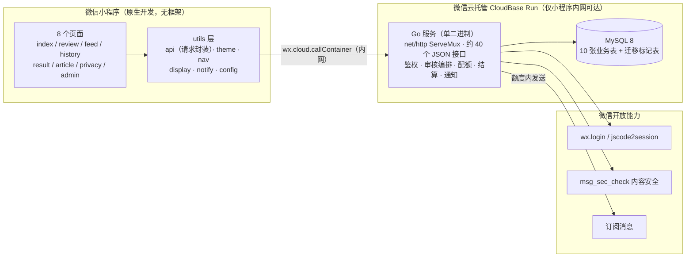
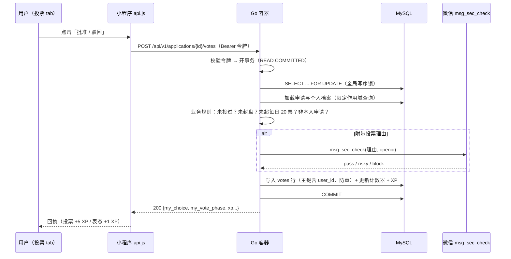

# 系统架构 · architecture.md

> 本文描述项目的真实架构。所有内容以开发仓库代码为依据（核对日期 2026-10-25）。

## 1. 全景图

要点：

- **没有公网 API 域名**。小程序通过 `wx.cloud.callContainer` 走微信云托管的内网信道调用后端，天然免域名备案、免 HTTPS 证书管理，请求头由平台注入可信身份。
- **后端是单二进制**：Go 编译的静态可执行文件，唯一第三方依赖是 MySQL 驱动；管理页（一个 HTML）由 `go:embed` 内嵌，随二进制一起部署。
- **数据库只在云托管内网可达**，凭据通过环境变量注入容器。

## 2. 双运行形态

同一份代码支持两种形态，由环境变量切换，业务逻辑完全复用：

| | 本地开发形态 | 云端形态 |
| --- | --- | --- |
| 存储 | JSON 快照文件（原子写：临时文件 + rename） | MySQL（10 张业务表） |
| 登录 | 可选游客模式（`DEV_ALLOW_GUEST=1`，仅调试） | 强制微信登录，禁用游客 |
| 内容安全 | 可不配置（自由文本接口返回 503） | 强制接入 `msg_sec_check` |
| 用途 | 本地调试、演示、跑不依赖 MySQL 的测试 | 线上运行 |

本地形态并非玩具：它同样有互斥锁、快照回滚与原子写盘，云端测试大量复用本地形态跑业务逻辑，只在存储层切换实现。

## 3. 后端模块划分

后端无 Web 框架、无 ORM，采用「HTTP 分发 + Store 领域逻辑 + 云端仓储」的结构（约 7300 行实现代码 + 4000 行测试）：

| 模块 | 职责 |
| --- | --- |
| `main.go` | 类型定义、Store（领域逻辑：申请/投票/结算/配额/XP）、路由分发、鉴权、统一响应 |
| `community.go` | 评论 / 回复 / 点赞 / 举报 / 管理复核 |
| `articles.go` | 文章系统（栏目、状态机、校验、管理操作与审计） |
| `requests.go` | 隐私请求 / 内容申诉（五类、状态机、限流） |
| `notify.go` | 订阅消息（模板配置、token 缓存、授权额度、异步发送） |
| `cloud_store.go` / `cloud_repository.go` / `cloud_delegates.go` | MySQL 连接池、schema 迁移、按需加载与差量落库、把业务方法包进事务的委托层 |
| `cloud_backup.go` | 备份 / 恢复（一致性快照事务 + SHA-256 校验和） |
| `wechat_client.go` / `wechat_moderation.go` | 微信 API 客户端（云托管代理证书懒加载）、内容安全与登录、openid 加密存储 |
| `seed*.go` | 演示内容与冷启动选题（幂等补种、时间槽轮换） |
| `admin.go` + `admin.html` | 内嵌管理页（仅回环地址可访问） |

分层说明：**没有经典的 Handler/Service/Repository 三层**。`Store` 同时承担领域逻辑与状态管理（本地模式直接持有内存态）；云端模式下 `cloudStore` 作为仓储按需加载实体、差量写回，业务方法不变。这是一个刻意的小规模取舍——接口数量与团队规模（个人项目）不值得引入更深的分层，但它确实把「业务规则」与「存储细节」隔离在两类文件中。

## 4. 一次投票的完整生命周期

到期后的结算由请求触发的 `settle` 步骤完成（读写路径都会先尝试推进状态机），以快照方式变更并保证幂等；出结果后异步（goroutine + recover）发送订阅消息通知申请人。

## 5. 前端模块划分

| 模块 | 职责 |
| --- | --- |
| `utils/api.js` | 统一请求封装：`wx.cloud.callContainer` 传输、Bearer 令牌注入、自动登录、401 换令牌重放一次、GET 冷启动退避重试（1.2s/3s/6s）、管理密钥请求隔离 |
| `utils/theme.js` | 主题注册表与原生外壳同步（导航栏 / tabBar 颜色与图标） |
| `utils/display.js` | 纯展示派生：状态字典、倒计时、票数缩写、头像解析 |
| `utils/nav.js` | 自定义导航栏度量（状态栏高度 + 胶囊位置） |
| `utils/notify.js` | 订阅消息授权闭环（点击手势内弹授权、上报额度） |
| 8 个页面 | 见 [features.md](features.md) |

前端刻意不用任何跨端框架或状态管理库——8 个页面 + 页面间 storage 意图传递（如「从文章发起申请」）的规模下，原生开发反而是最低的维护成本。

## 6. 关键设计决策

| # | 决策 | 为什么 |
| --- | --- | --- |
| 1 | **标准库 `net/http` 而非 Gin** | 约 40 个接口的规模下，框架省下的样板代码远小于引入的抽象成本；Go 1.22+ 的方法匹配路由（`"GET /health"`）已足够表达，且完全掌控超时、响应格式与错误语义 |
| 2 | **自研 HMAC 令牌而非 JWT 库** | 需求只有「7 天有效的无状态用户令牌」，20 行实现 + 常量时间比较即可，不引入解析第三方 token 的攻击面 |
| 3 | **双存储同构** | 本地 JSON 让「跑通业务」不需要装数据库，也让大量业务测试不依赖 MySQL；MySQL 形态只换存储层 |
| 4 | **fail-closed 审核** | 内容安全接口不可用时宁可拒绝发布（503），绝不放行未审内容；人工复核结果永不被自动流程覆盖 |
| 5 | **全局写序锁 + 短事务** | 用一条 `FOR UPDATE` 行锁串行化写操作，换取「业务代码可以当单线程写」的心智模型；实测对当前量级的吞吐完全够用（见 [backend.md](backend.md) 的取舍讨论） |
| 6 | **票数保密 + 平票语义** | 投票中的申请不显示赞成比例、不足 3 票或平票统一显示「未形成有效结果」，防止早期票数带节奏，也避免「50% 赞同」的伪精确 |
| 7 | **主题用容器类作用域** | 页面根节点挂 `t-clean/t-retro/t-fun`，全部颜色走 CSS 变量；原生外壳（导航栏/tabBar）由 JS 同步，一套代码三套皮 |

## 7. 已知边界（如实记录）

- 写路径的全局写序锁是吞吐上限：适合当前个人项目的量级，不适合高并发场景；
- 除广场外，其余列表接口仍使用 OFFSET 分页（广场已升级 keyset 游标）；
- 自动审核无重试队列：`msg_sec_check` 瞬时失败会让该次发布直接 503，由用户重试；
- 订阅消息在云端可能先于事务提交发出（极小概率的不一致窗口，代码内有注释声明）；
- 本地 JSON 模式的订阅消息授权额度不落盘，重启即失效（有意简化）。

这些边界均写入开发仓库的技术文档并配有测试，属于「知道且接受」的取舍，不是遗漏。
