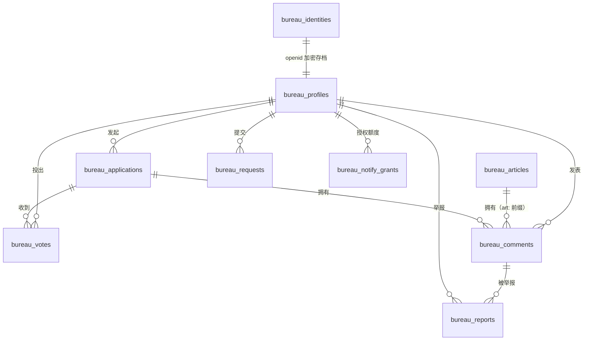
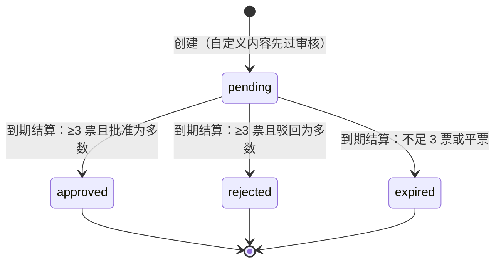

# 数据模型 · database.md

> 基于开发仓库真实 schema 整理（核对日期 2026-10-25）。本文不包含任何真实用户数据。

## 1. 总览

云端 MySQL 共 12 张表：**10 张业务表 + 1 张迁移标记表 + 1 张只读遗留快照表**，统一 `bureau_` 前缀。本地开发形态使用同构的 JSON 快照文件（版本化，当前 version 7），字段语义与云端一致，由契约测试保证行为一致。

## 2. 核心业务表

### bureau_applications — 申请（核心实体）

| 字段 | 说明 |
| --- | --- |
| `id` | 主键（uuid；演示数据用 `demo-*` 短 ID） |
| `owner_id` | 申请人（对应 bureau_profiles） |
| `topic` / `title` / `reason` | 主题 ID / 标题（预设或自定义）/ 申请理由 |
| `source_article_id` | 来源文章（从文章发起申请时的转化闭环，可空） |
| `duration_minutes` | 投票时长（15/30/60） |
| `status` | `pending` → `approved` / `rejected` / `expired` |
| `approves` / `rejects` | 正式票计数（冗余列，供列表查询） |
| `post_approves` / `post_rejects` | 截止后「后续表态」计数（不改变结果） |
| `expires_at` / `decided_at` | 投票截止 / 结算时间（结算时 = 截止时间） |
| `outcomes` | 申请人追加的后续故事线（JSON，≤5 条） |
| `top_comment_id` | 神评论（点赞最高，详情页置顶） |

**状态机**：

结算幂等：重复结算不改变任何状态；结算同时为多数派投票者发放 XP。

### bureau_votes — 投票

| 字段 | 说明 |
| --- | --- |
| `application_id, user_id` | **复合主键**——存储层杜绝重复投票 |
| `choice` | approve / reject |
| `phase` | `formal`（正式）/ `late`（截止后表态） |
| `reason` | 可选投票理由（以立场评论形式公开，需过审核） |
| `created_at` | 投票时间 |

同一用户的正式票与后续表态是两行独立记录（phase 不同），「后续表态不改已锁定结果」由 phase 字段与结算规则共同保证。

### bureau_comments — 评论（申请与文章共用）

| 字段 | 说明 |
| --- | --- |
| `id` | 主键；目标申请的评论 ID 即申请 ID，文章评论 ID 带 `art:` 前缀 |
| `author` | 评论者 |
| `body` | 内容（2–100 字，禁链接 / @ / 换行） |
| `parent_id` / `reply_to` | 楼中楼（两级） |
| `stance` | 批准派 / 驳回派（由投票理由生成的立场评论携带） |
| `status` | `pending` → `approved` / `rejected`；**初始一律 pending（先审后发）** |
| `likes` | 点赞集合（toggle 去重，仅 approved 可赞） |
| `deleted` | 软删除标记（保留占位，回复链不断裂） |

### bureau_reports — 举报

| 字段 | 说明 |
| --- | --- |
| `reporter_id, comment_id` | **复合主键**——每人每条评论只可举报一次 |
| `reason` | 枚举（三类理由） |
| 状态语义 | 同一评论累计 ≥3 名举报人 → 评论自动转 pending 隐藏，转人工复核；管理员恢复评论后举报记录仍可查（独立表的价值） |

### bureau_articles — 文章（编辑部内容）

| 字段 | 说明 |
| --- | --- |
| `id` | 主键（演示内容 `v2-*`） |
| `title` / `lead` / `paragraphs` | 标题（4–30 字）/ 导语 / 正文（1–20 段，JSON） |
| `column` | 栏目：today / human / lab |
| `status` | `draft` → `published` ⇄ `offline`（可重新上架） |
| `featured` | 精选位（列表优先排序） |
| `audit` | **追加式审计记录**：每次操作记录操作者 / 动作 / 时间，业务接口无修改或删除路径 |

### bureau_requests — 隐私请求与申诉

| 字段 | 说明 |
| --- | --- |
| `id` / `requester_id` | 主键 / 发起人 |
| `kind` | 五类：查阅 / 更正 / 删除 / 注销 / 内容申诉 |
| `target_comment_id` | 申诉目标评论（可空） |
| `status` | `pending` → `progress` → `resolved` / `rejected`（终态不可再流转） |
| `admin_note` | 处理说明（驳回必填理由——PII 删除请求驳回时必须给出依据） |
| 分组限流 | 同类请求按目标去重并限流，防滥用 |

### bureau_profiles — 用户档案

等级 / XP（投票 +5、多数派一致 +3、后续表态 +1）、参与计数（Reviews / Resolved / Aligned / PostVotes）、昵称与头像（微信头像 data URL 或系统预设 ID）。用户 ID 是 openid 的 HMAC 派生值，档案表不含任何明文身份。

### bureau_identities — 身份存档

仅在需要发送订阅消息时使用的 **AES-256-GCM 加密 openid** 存档，与档案表一对一。

### bureau_notify_grants — 订阅消息授权额度

前端 `wx.requestSubscribeMessage` 授权后上报一条额度；发送时**消耗最旧一条**（一次性授权语义）；无额度则静默跳过发送。与微信平台「一次授权一次下发」的规则对齐。

## 3. 基础设施表

| 表 | 用途 |
| --- | --- |
| `bureau_schema` | schema 版本标记（当前 V7）；其首行同时充当写事务的全局写序锁（`FOR UPDATE`） |
| `bureau_state` | 旧版本（V6）整体快照的只读遗留表，迁移后由触发器 `bureau_legacy_fence` 保护，禁止旧二进制写入 |
| `bureau_legacy_fence` | 触发器本身（阻止对 legacy 表的写入） |

## 4. 关键约束汇总

| 约束 | 层级 | 防什么 |
| --- | --- | --- |
| `votes` 主键 `(application_id, user_id)` | MySQL 主键 | 重复投票 |
| `reports` 主键 `(reporter_id, comment_id)` | MySQL 主键 | 重复举报 |
| 评论初始 `pending` | 应用层 + 数据默认值 | 未审内容公开 |
| 请求状态终态不可流转 | 应用层 | 已办结请求被篡改 |
| 文章审计追加式 | 应用层（无删除路径） | 管理操作抵赖 |
| 原子写盘 / 快照事务 | 本地 / 云端 | 半写状态 |

## 5. 数据边界声明

- 演示数据（`demo-*` 申请、`v2-*` 文章、角色评论）与真实用户数据在 ID 命名上即可区分，演示内容不计入任何真实指标；
- 本仓库（展示仓库）**不包含**数据库结构文件以外的任何数据，不含用户数据导出、不含备份文件；
- 运营者对用户行使更正 / 删除 / 注销时的操作规程属于开发仓库的内部安全文档，不在公开范围。
